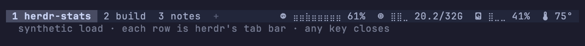
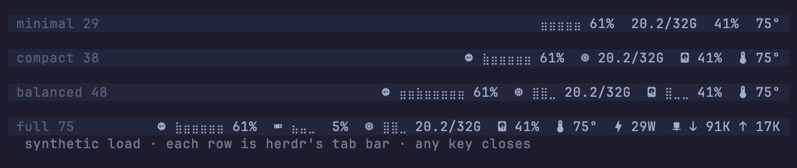

# herdr-stats

Live system stats in the top-right corner of [herdr](https://github.com/herdrdev/herdr)'s
tab bar: scrolling braille graphs, gauges and icons that react to the reading,
in fixed-width fields so the tabs beside them never shift.



- **cpu**: scrolling load history (or one bar per core) and percent
- **mem**: gauge and used/total GiB; alerts when macOS reports memory pressure
- **disk**: gauge and percent (or used/total) for any mount
- **temp**: the hottest CPU/GPU die (or one of them); the thermometer fills as it heats up and turns into an alert past a threshold
- **gpu**, **power** (watts), **fan**, **battery**, **net** (↓↑ rates and history), **load**

## Install

```sh
herdr plugin install jeffarese/herdr-stats
herdr plugin action invoke setup --plugin herdr-stats
```

The install downloads prebuilt binaries for macOS and Linux (x86_64 and
aarch64), checked against the release's checksums. It builds from source with
cargo (Rust 1.85+) when there is no binary for your machine.

`setup` (also the **Stats: show in tab bar** action) adds one entry to
`[ui] tab_bar_right` in herdr's config and reloads herdr. It keeps a backup next
to your config, leaves the rest of the file as it was, and follows a symlinked
config to its target. To take it out again, run the **Stats: remove from tab
bar** action, then `herdr plugin uninstall herdr-stats`.

From a checkout instead:

```sh
sh scripts/build.sh
herdr plugin link .
bin/herdr-stats setup                 # --preset P, --interval 1-60 (seconds)
```

## Presets



| preset   | width | shows                                      |
|----------|------:|--------------------------------------------|
| minimal  | 29    | cpu graph, memory, disk, temp, no icons    |
| compact  | 38    | the same with icons                        |
| balanced | 48    | adds memory and disk gauges (the default)  |
| full     | 75    | adds gpu, power and network                |

The **Stats: preview presets** action shows them all, live, on a mock of your
own tab bar (`herdr-stats preview --presets`; add `--demo` for synthetic load).

## Config

`~/.config/herdr/plugins/config/herdr-stats/config.toml` is created on first
start with every option listed and commented out; the **Stats: edit config**
action opens it. Changes apply within two seconds, no reload needed.

```toml
preset = "balanced"
# modules = ["cpu", "mem", "disk", "temp"]   # any order; also gpu, net, power, fan, battery, load
# icons = "nerd"     # nerd (needs a Nerd Font) | text | none
# style = "braille"  # braille | blocks
# alerts = "icon"    # icon | blink | emoji | off

# [cpu]
# graph = "history"  # history | cores | none
# width = 8

# [temp]
# sensor = "hottest" # hottest | cpu | gpu | soc
# unit = "c"         # c | f
# warm = 50          # thermometer thresholds, °C
# hot = 80
# critical = 100
```

herdr keeps 80 characters of the line. A layout longer than that loses its last
modules whole rather than being cut mid-number.

## How it works

herdr runs the tab bar command through a shell every second. That command is
`herdr-stats-bar`, a 350 KB client that asks a background daemon for the current
line over a Unix socket and prints it: under a millisecond on top of herdr's
own shell. The daemon reads the machine through native APIs (Mach, sysctl,
IOKit, the SMC and the HID sensor hub on macOS; procfs and sysfs on Linux),
spreads the slower sensors over time, and keeps the history the graphs scroll
through, in about 10 MB. herdr starts it on the first tick. It exits after three
idle minutes, and it restarts itself when the plugin is updated.

The **Stats: doctor** action (`herdr-stats doctor`) lists the sensors found, the
cost of each read, the daemon's state and every preset's line. `herdr-stats
status` shows whether the daemon is running; its log is
`~/.local/state/herdr/plugins/herdr-stats/daemon.log`.

## Platforms

- **macOS on Apple Silicon**: everything. This is where it is developed.
- **macOS on Intel**: should work but is untested. Temperatures come from
  Apple Silicon's sensor hub, so expect the temp module to hide there.
- **Linux**: cpu, memory, disk, network, load, battery, AMD GPU busy, and the
  CPU temperature from hwmon. Power is the battery's discharge rate, so it
  shows only on battery. No fans.

## Limits

herdr draws this part of the tab bar in a single colour and strips escape
codes, so the stats cannot turn red when something is hot; the icons and
gauges carry that instead. It also hides the stats when the tabs need the room.
The icons need a [Nerd Font](https://www.nerdfonts.com); set `icons = "text"`
otherwise.

## License

MIT
